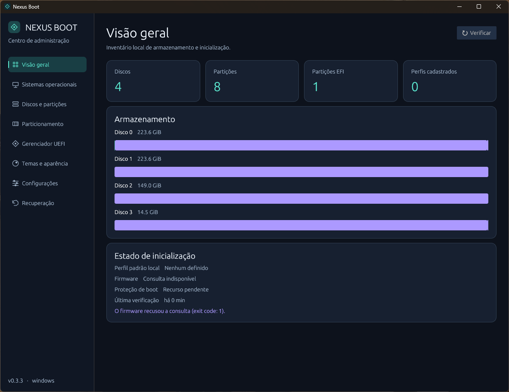
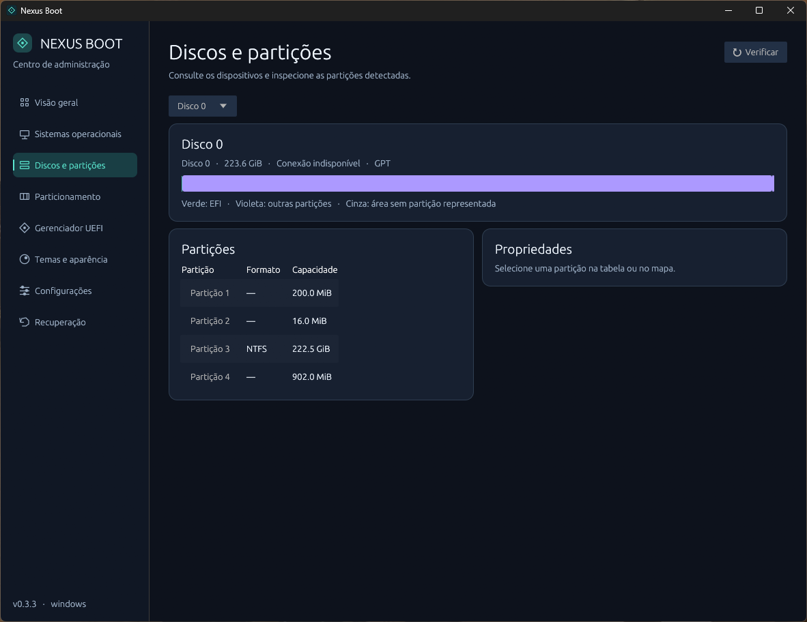
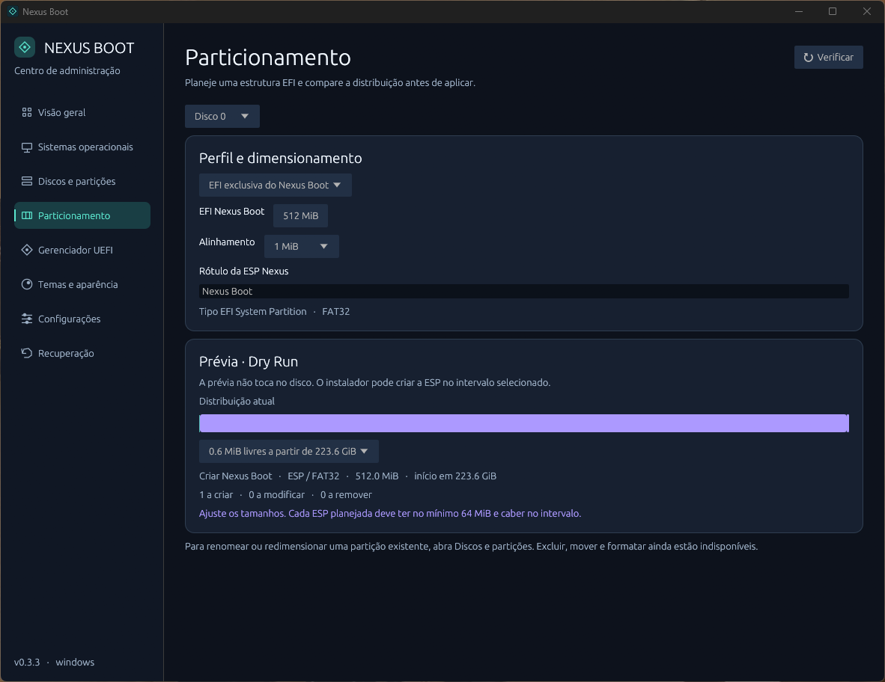
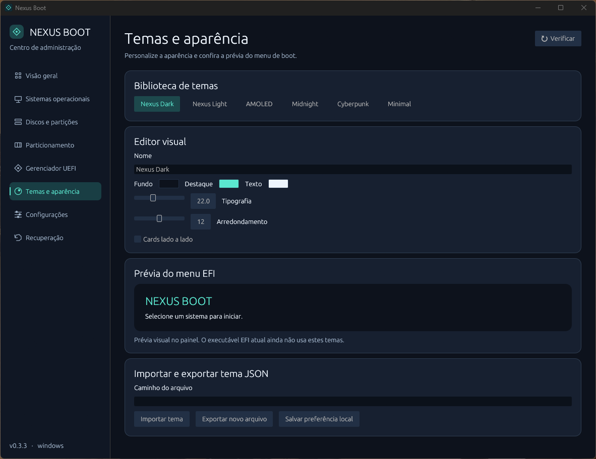
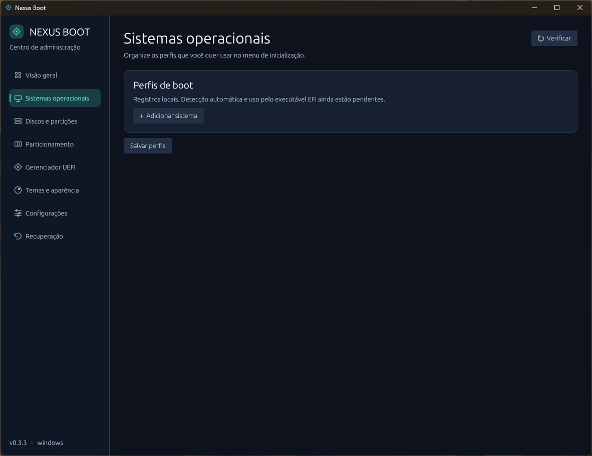
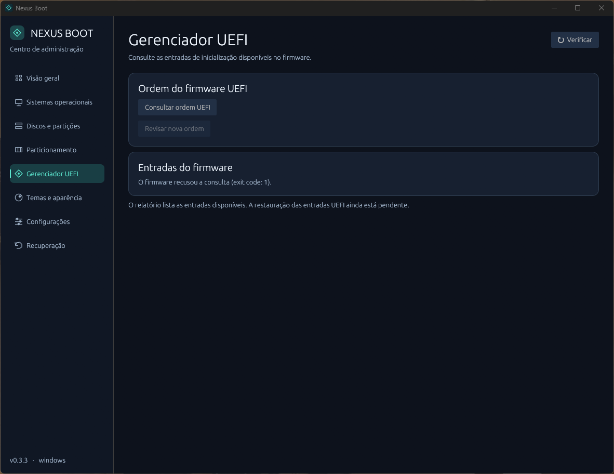
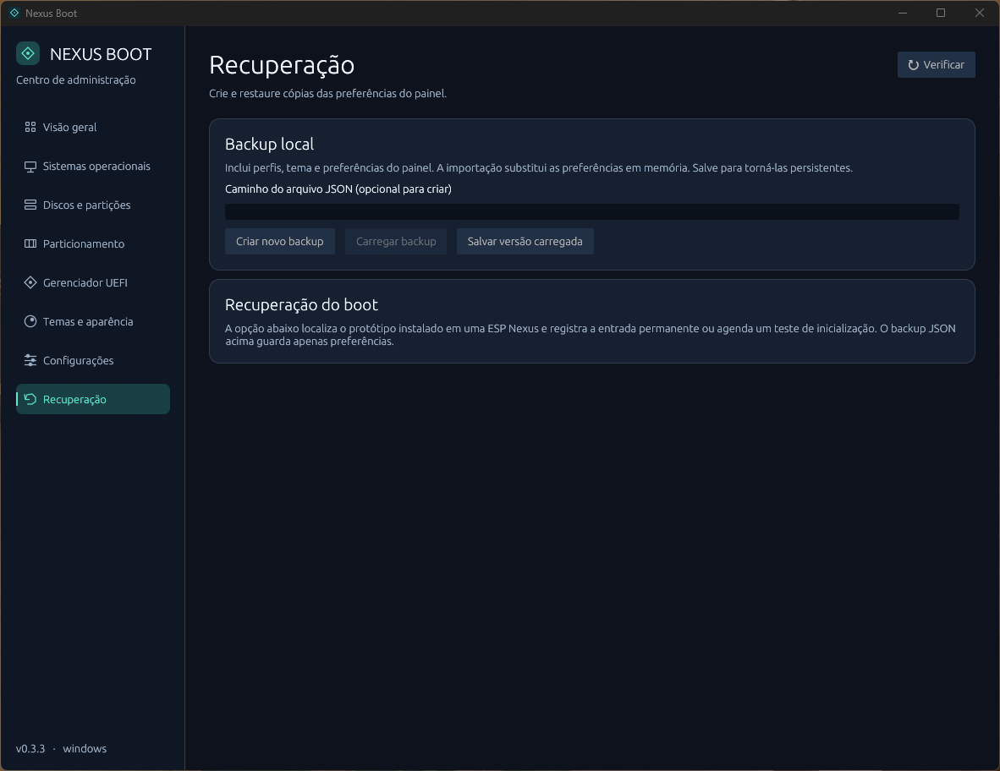

# Nexus Boot

Gerenciador de inicialização UEFI em Rust com painel administrativo para Windows e Linux. O seletor x86_64 detecta carregadores EFI compatíveis e permite escolher qual iniciar.

Veja a [arquitetura do projeto](docs/arquitetura.md).

## Downloads

A versão 0.3.3 oferece o painel portátil para Windows x64 e o instalador para
Linux x86-64. Os binários, hashes SHA-256 e o código correspondente ficam na
[release 0.3.3](https://github.com/eritongrnascimento-svg/nexus-boot/releases/tag/v0.3.3).

No Windows, execute o arquivo .exe. No Linux, dê permissão de execução ao .run
e abra-o a partir da sessão gráfica. Consulte as instruções abaixo antes de
alterar partições ou entradas do firmware.

## Compilação

Use Rust estável recente via rustup e, para o teste, QEMU x86_64 com OVMF.
Execute a partir da raiz do repositório.

```text
rustup update stable
rustup target add --toolchain stable x86_64-unknown-uefi
cargo +stable test -p nexus-core
cargo +stable build-efi
```

O binário esperado é target/x86_64-unknown-uefi/release/nexus-efi.efi.

## Teste com QEMU e OVMF no Windows

Informe o caminho de um par OVMF_CODE e OVMF_VARS compatível, da mesma distribuição
e tamanho de flash. Use uma variante de desenvolvimento que aceite a imagem
EFI sem assinatura. Execute o script abaixo em PowerShell. O teste cria uma pasta
temporária sob target, expõe ao convidado apenas uma unidade FAT virtual e grava
variáveis do firmware numa cópia descartável. Na janela do QEMU, aguarde o seletor Nexus Boot. Em uma mídia que contenha apenas a aplicação Nexus, Esc retorna ao firmware.
Feche o QEMU ao concluir.

```powershell
./scripts/test-qemu.ps1 -OvmfCode 'C:/caminho/OVMF_CODE.fd' -OvmfVars 'C:/caminho/OVMF_VARS.fd'
```

## Painel e instalador

Compile o painel com cargo build --release --locked -p nexus-manager. O
executável fica em target/release/nexus-manager no Linux e em
target/release/nexus-manager.exe no Windows. A interface usa eframe. O
inventário usa lsblk no Linux e Get-Disk/Get-Partition no Windows.

### Navegação do painel

- **Visão geral** mostra o inventário e o estado observado do firmware.
- **Sistemas operacionais** permite cadastrar, ordenar, ocultar, editar e remover perfis locais.
- **Discos e partições** mostra o mapa proporcional, a tabela e os detalhes da partição selecionada.
- **Particionamento** calcula intervalos livres estimados para GPT/discos vazios e simula cinco perfis de ESP. O Dry Run não modifica discos. No perfil Nexus Boot, o instalador Linux usa o intervalo selecionado para criar a ESP em GPT ou em disco sem tabela.
- **Gerenciador UEFI** consulta o relatório do firmware quando o sistema permite acesso.
- **Temas e aparência** oferece seis predefinições, editor com prévia em tempo real e importação/exportação JSON.
- **Configurações** guarda a escala e as preferências de boot no perfil local.
- **Recuperação** exporta e carrega backups JSON das preferências locais.

Em Configurações, o botão Adicionar Nexus Boot ao menu do sistema instala um atalho com ícone para o usuário Linux.

No Linux, abra o executável em dist/NexusBoot-0.3.3-linux-x86_64.run
em uma sessão gráfica x86_64 com glibc 2.43 ou posterior. Se a cópia perder
a permissão de execução, execute chmod +x no arquivo antes de abri-lo.
Os perfis, temas e preferências do painel ainda não são consumidos pela EFI.
A consulta do firmware pode exigir permissões do sistema. A edição real fica em Discos e partições. O Linux permite alterar o nome GPT e ampliar ou reduzir ext4 desmontado. Para a partição do sistema, execute a partir de um Linux live. A expansão exige espaço contíguo após a partição. O aplicativo guarda uma cópia da tabela GPT em /var/backups/nexus-boot antes de gravar. Essa cópia não inclui o conteúdo do volume.

### Instalação guiada no CachyOS

Inicie a VM em modo UEFI e abra o painel gráfico. Selecione um disco GPT com espaço não alocado ou um disco virtual vazio. O sistema precisa de um agente
gráfico do Polkit, pkexec, Bash, util-linux recente, dosfstools, udev, efibootmgr
e systemd. O Linux deve conseguir acessar as variáveis EFI. O painel
solicita autenticação administrativa nas etapas que gravam no disco.

1. Em Particionamento, escolha o disco e o perfil EFI exclusiva do Nexus Boot. Selecione o intervalo livre e ajuste o tamanho sugerido de 512 MiB.
2. Abra o instalador e confirme a criação da ESP em FAT32 no intervalo exibido. As partições existentes são preservadas.
3. Confirme separadamente a instalação. O instalador leva o aplicativo EFI e a configuração TOML incorporados. Ele grava o carregador no diretório NexusBoot e no caminho de fallback da ESP recém-criada.
4. Ao concluir, agende o teste no próximo boot e reinicie normalmente. Para uma ESP que já existe, use Recuperação para instalar os arquivos EFI se estiverem ausentes e agendar o teste. Você também pode escolher reiniciar no setup UEFI. O firmware precisa oferecer suporte ao reinício direto. Selecione Nexus Boot ou o novo disco na interface do firmware.

O instalador registra uma entrada EFI sem alterar BootOrder. Para incluí-la na lista permanente preservando a prioridade atual, selecione Adicionar ao menu UEFI permanente em Recuperação. O painel faz backup da ordem anterior antes de alterá-la. Dependendo do
firmware, é preciso adicionar ou escolher a entrada pela opção de inicializar
um arquivo EFI. O seletor EFI incorporado ainda não é assinado. Em Recuperação, use Atualizar seletor EFI e depois Definir Nexus como primeira opção de boot. O painel salva a ordem anterior e mostra a ordem confirmada pelo firmware. Em Recuperação, Diagnosticar boot UEFI consulta a versão do EFI e a prioridade atual sem gravar na ESP ou no firmware. Ao concluir a instalação, o próprio assistente permite mover o Nexus para o início ou para o fim. O seletor lista carregadores compatíveis, com setas para navegar, Enter para iniciar e Esc para retornar ao firmware.

### Reparação pelo seletor EFI

Uma instalação nova tenta copiar os arquivos de boot compatíveis das ESPs FAT
existentes para o diretório EFI/NexusBoot/Backups na ESP do Nexus. Em uma
instalação que já existe, atualize o seletor e use Copiar arquivos EFI dos sistemas para esta ESP do Nexus em
Recuperação. A pasta é identificada pelo PARTUUID GPT da ESP de origem e pelo
diretório do carregador. Cópias existentes são preservadas.

No boot, selecione Reparação de boot, escolha o sistema e confirme a restauração.
O seletor exige que a ESP original ainda esteja acessível e que os hashes SHA-256
confiram antes da gravação. Se um arquivo existente for substituído, a primeira
versão encontrada no destino é preservada com o sufixo .nexus-previous.

O conjunto inclui carregadores EFI compatíveis e arquivos auxiliares reconhecidos,
como grub.cfg e o BCD do Windows. O procedimento não restaura partições apagadas,
dados do sistema, volumes criptografados ou registros de inicialização do firmware.

## Galeria



| Discos e partições | Particionamento |
| --- | --- |
|  |  |
| **Temas e aparência** | **Sistemas operacionais** |
|  |  |
| **Gerenciador UEFI** | **Recuperação** |
|  |  |

**Linux e UEFI.** [Painel de recuperação no Linux](docs/capturas/painel-recuperacao-031.png) · [Seletor EFI com reparação de boot em QEMU](docs/capturas/seletor-efi-030.png)

## Windows

No Windows x64, compile o painel com cargo build --release --locked -p nexus-manager.
O painel oferece inventário, perfis e temas locais, planejamento e consulta UEFI.
A versão Windows também permite reordenar entradas já registradas no firmware em
Gerenciador UEFI. O painel registra a ordem anterior, grava somente a nova
sequência dos mesmos identificadores e relê a configuração. Execute como
administrador para consultar e editar a ordem.

Em Discos e partições, a edição Windows atende volumes NTFS de dados em GPT.
Permite alterar o rótulo do volume e redimensioná-lo dentro dos limites
informados pelo Windows. O painel não aplica essas alterações à ESP ou às
partições usadas pelo Windows para iniciar.

A instalação na ESP, o agendamento único e o backup dos arquivos EFI do sistema
continuam disponíveis pelo painel Linux. A restauração no seletor funciona no
ambiente UEFI quando há uma cópia compatível. As instruções de compilação preservam o ícone nativo quando o Windows SDK está disponível.

## Licença e identidade visual

O código próprio é distribuído sob a [GNU GPL v3.0](LICENSE).
Consulte o [aviso de identidade visual](TRADEMARKS.md) sobre nome e logotipo.
